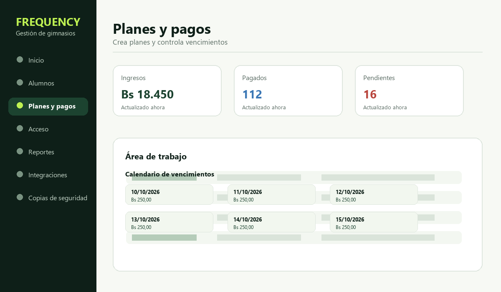

# Frequency — gestão de academia

Sistema web para gestão de academia: alunos, planos e cobranças, controle de acesso, relatórios, integrações e cópia de segurança. Interface em português e espanhol, API em FastAPI e banco PostgreSQL.



## O que tem dentro

| Módulo | O que faz |
|---|---|
| Alunos | cadastro, ficha, evolução e treinos |
| Planos e pagamentos | criação de planos, vencimentos, inadimplência |
| Acesso | entrada de alunos e controle de recepção |
| Relatórios | indicadores de frequência e recebimento |
| Integrações | publicação, catálogo e conexões externas |
| Cópias de segurança | backup e restauração do banco |

## Stack

- **Backend:** Python, FastAPI, PostgreSQL, SQLAlchemy, migrações versionadas
- **Frontend:** React, TypeScript, Vite
- **Mobile:** app do aluno em Expo/React Native
- **Infra:** Docker, Caddy como proxy reverso

## Estrutura

```text
backend/      API, modelos, rotas, migrações e testes
frontend/     aplicação web (src, public)
docs/         manual do cliente, arquitetura e contratos de API
tools/        scripts de operação
```

## Rodando localmente

```bash
# backend
cd backend
python -m venv .venv && . .venv/bin/activate   # Windows: .venv\Scripts\activate
pip install -r requirements.txt
uvicorn main:app --reload

# frontend
cd frontend
npm install
npm run dev
```

As variáveis de ambiente seguem o modelo em `backend/.env.example`. Nenhuma credencial real está no repositório.

## Estado do projeto

Em desenvolvimento. Cada módulo tem seu próprio estágio de validação; este repositório é o código-fonte, não um produto lançado.

Os dados que aparecem nas capturas são de demonstração. O manual em `docs/manual_cliente/` foi escrito para acompanhar a entrega.

## O que **não** está aqui

- banco de dados, backups e dados reais de academia
- arquivos `.env`, chaves, tokens e certificados
- instaladores e binários (publicados fora do Git)

## Autor

Gabriel de Moura Pereira — [portfólio](https://tufenor.github.io/portfolio/) · [GitHub](https://github.com/tufenor)
